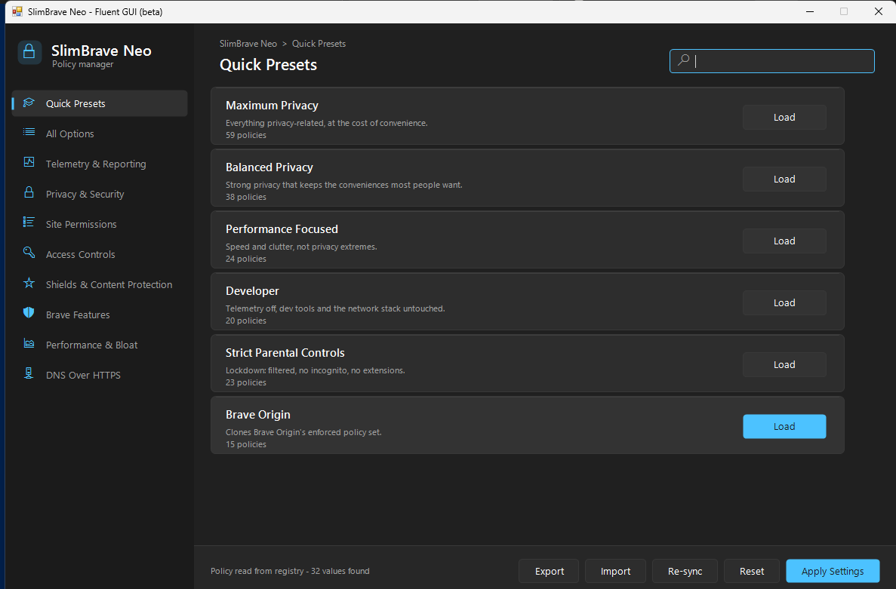
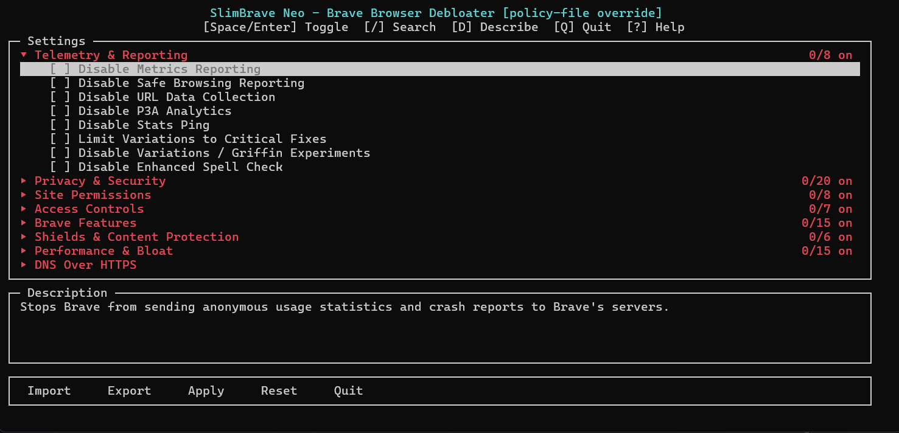

<div align="center">

# SlimBrave Neo


**Debloat and harden Brave Browser on Linux, macOS, and Windows.**

[](https://python.org)
[]()
[](LICENSE)
[]()
[]()
[]()

SlimBrave Neo uses Chromium enterprise managed policies to disable telemetry, bloat, and unwanted features in Brave Browser. No browser extensions, no hacks, just clean policy enforcement that Brave respects natively.

</div>

> [!IMPORTANT]
> **Source code only — no `.exe`, `.msi`, `.dmg` or installers, ever.** This repository is the only official source; a download claiming to be SlimBrave Neo anywhere else is not from this project. See [`SECURITY.md`](SECURITY.md).

> [!NOTE]
> A fork of [SlimBrave](https://github.com/ltx0101/SlimBrave) by [@ltx0101](https://github.com/ltx0101), GPL-3.0, extended to Linux and macOS. Policy keys are curated and re-audited against brave-core and Chromium source by Claude Fable; what ships is a human call. Receipts in [`AUDIT.md`](AUDIT.md).

> [!NOTE]
> **Linux users: consider [Brave Origin](https://brave.com/origin/linux/) first** — an official Brave build with telemetry and bloat already removed, now on the Release channel (`apt install brave-origin`). SlimBrave Neo is the better fit if you want per-policy control, presets, or your own DoH templates — and it runs on Origin too: the Arch `brave-origin-bin` package and the `brave-origin` deb/rpm are detected, and Origin reads the same `/etc/brave/policies` directory, so everything Origin has not already compiled out applies there as well.

<div align="center">

---



*The Windows GUI, on All Options: every policy in one scroll, each with a plain-English description under its title. A sidebar splits them into categories, and the search reads the descriptions as well as the names.*

</div>

---

## Quick Start

### Windows

```powershell
git clone https://github.com/ChaoticSi1ence/SlimBrave-Neo.git
cd SlimBrave-Neo
powershell -ExecutionPolicy Bypass -File .\SlimBrave.ps1
```

**No git?** One line:

```powershell
iwr "https://raw.githubusercontent.com/ChaoticSi1ence/SlimBrave-Neo/main/SlimBrave.ps1" -OutFile "SlimBrave.ps1"; powershell -ExecutionPolicy Bypass -File .\SlimBrave.ps1
```

This pulls the current `main`. If you'd rather pin an exact, unchanging version and check it against a published checksum before running, [`SECURITY.md`](SECURITY.md) covers tagged releases and SHA-256 sums.

> **"running scripts is disabled on this system"?**
> That is Windows' default execution policy (`Restricted`) refusing to run any
> `.ps1`, and it is why both commands above end in
> `powershell -ExecutionPolicy Bypass -File` rather than `.\SlimBrave.ps1`.
> The bypass applies to that one launch only — it changes no setting on your
> machine, and you never need `Set-ExecutionPolicy`. If you hit the error, you
> ran a copy of the one-liner without that part; re-run the version above.

**Prefer the previous layout?** [v2.1.0](https://github.com/ChaoticSi1ence/SlimBrave-Neo/releases/tag/v2.1.0)
is the last release with the three-column window. It keeps working; it just won't
receive the newer fixes. Pinned to that tag, either way:

```powershell
git clone -b v2.1.0 --depth 1 https://github.com/ChaoticSi1ence/SlimBrave-Neo.git
cd SlimBrave-Neo
powershell -ExecutionPolicy Bypass -File .\SlimBrave.ps1
```

```powershell
iwr "https://raw.githubusercontent.com/ChaoticSi1ence/SlimBrave-Neo/v2.1.0/SlimBrave.ps1" -OutFile "SlimBrave.ps1"; powershell -ExecutionPolicy Bypass -File .\SlimBrave.ps1
```

A tag never moves, so both of those fetch the same file every time.

Requires Administrator privileges; the script re-launches itself elevated. It opens showing the policy already on the machine.

**Every policy explains itself.** Each row carries a plain-English description under its title — *"Stops the daily usage ping that counts this install in Brave's active-user statistics, plus the search-engine usage counts it carries and the referral-code check"* — rather than hiding it in a tooltip. Where the text is longer than the row, a chevron expands it in place.

**Search reads the descriptions, not just the names.** The box in the header matches titles, policy keys, category names *and* the description text, so typing `passwords` surfaces "Require HTTPS for Basic Auth" even though its title never says the word, and `telemetry` returns the whole reporting section. Several words narrow the results, plurals match singulars, punctuation is ignored on both sides, and title matches rank above prose matches.

**A sidebar splits the policies into seven categories** — or skip it entirely: **All Options** lists all 91 in one scroll with section headers, for anyone who would rather not navigate.

**Presets are cards.** Each shows what it does and how many policies it sets. Loading one only fills in the controls; nothing reaches the registry until you press Apply Settings, so you can change your mind first. The presets are embedded in `SlimBrave.ps1` itself, so they work for the one-liner download above with no `Presets/` directory on disk.

**Clicking a label does nothing.** Only the toggle and the dropdown respond, each within its own bounds. Opening a menu is reversible; flipping a machine-wide policy is not.

**It works without a mouse.** Tab moves between the sidebar, the search box, the list and the button row; Space or Enter presses whatever has focus, on release, so a held key acts once. Right opens a row's description and Left closes it. Escape clears a search, or closes the window — asking first if there are staged changes.

<details>
<summary><strong>The GUI — keys</strong></summary>

| Key | Action |
|-----|--------|
| Tab / Shift+Tab | Sidebar → search → list → buttons (Export first), and round again |
| Up / Down | Previous / next item |
| PageUp / PageDown / Home / End | Move through the list |
| Space / Enter | Toggle, open a dropdown, load a preset, pick a page, press a button |
| Right / Left | Open / close a row's description |
| Escape | Clear the search; otherwise close the window, asking if changes are staged |

A dotted outline marks the focused control. It appears once the keyboard moves focus, so a mouse session never shows it.

</details>

The button row is Export, Import, **Re-sync**, Reset and Apply Settings. Re-sync reads the policy currently in the registry back into the interface, discarding on-screen selections you have not applied. It writes nothing, and goes through the same reader that fills the form at startup, so a re-sync can never disagree with a fresh launch.

Every content-setting row of Site Permissions is a dropdown rather than a checkbox: **Not managed / Ask / Block**, plus **Allow** on the keys where Chromium accepts it; Web Notifications leaves out Ask. Not managed is the default and writes nothing at all. The two rows at the end, Block Microphone Access and Block Camera Access, are plain checkboxes. The Site Permissions section below covers what each state does and which keys offer Allow.

---

### Linux

<div align="center">



*The Linux/macOS TUI: collapsible categories with a live count of what each one is managing, a description pane for whatever the cursor is on, `/` to search, `?` for keys. Zero dependencies, runs in any terminal.*

</div>

```bash
git clone https://github.com/ChaoticSi1ence/SlimBrave-Neo.git
cd SlimBrave-Neo
sudo python3 slimbrave-linux.py
```

That's it. No `pip install`, no `jq`, no external dependencies. Just Python 3 and root.

<details>
<summary><strong>The TUI — keys, folding and search</strong></summary>

With no flags the script opens a curses interface: seven collapsible categories — Telemetry & Reporting, Privacy & Security, Site Permissions, Access Controls, Brave Features, Shields & Content Protection, Performance & Bloat — followed by a DNS Over HTTPS section, with an Import / Export / Apply / Reset / Quit button row underneath.

Each category header carries a disclosure marker and a live `n/m on` count of the settings under it that are actually managed — a ticked checkbox, or a selector sitting off *Not managed*. The count updates as you toggle, so a folded section still tells you whether anything inside it is set. Left folds a header, Right unfolds it, Space or Enter does either, and `c` folds every section at once — or unfolds them all when they are already folded. On launch the folds reflect what is already applied: a section holding a managed setting opens, the rest stay folded — so a clean machine opens on a short overview and a configured one opens on what it is enforcing.

`/` filters the list by row name. Matches narrow as you type, the hint line reports how many rows matched, and only matching rows and the headers owning them stay on screen. Folded sections are searched too, so a fold cannot hide a match. Esc clears the filter and puts the fold states back as they were before the search.

The nine tri-state permission rows render as `Web Notifications: < Block >` and are cycled with Left/Right, the same way the DNS mode selector has always worked; Space or Enter steps forward through the same states. A row sitting off *Not managed* is highlighted and counts toward the header above it.

**Every row explains itself here too.** A boxed pane under the list shows the plain-English description of whatever the cursor is on - the same text the Windows GUI shows under each row - and, on the button row, what each button does. It starts shown wherever there is room for it; `d` hides it to give the list the rows back, and on a terminal too short to hold both it steps aside on its own. The pane takes as many lines as the longest description needs at that width, up to four; one that still does not fit ends in an ellipsis, and a wider terminal shows more of it. The list and the buttons sit in frames of their own.

`?` opens a key overlay over the list.

| Key | Action |
|-----|--------|
| Up / Down | Move the cursor; Down past the last row jumps to the button row |
| PageUp / PageDown | Move one screenful |
| Home / End | Jump to the first / last row |
| Left / Right | Cycle a selector, fold / unfold a header, or move along the button row |
| Space | Toggle a checkbox, cycle a selector, fold or unfold a header |
| Enter | The same, and presses the focused button |
| `c` | Fold every section, or unfold them all |
| `/` | Filter rows by name |
| `d` | Show or hide the description pane |
| Esc | Clear the filter; quit when no filter is active |
| `?` | Show the key overlay |
| Tab | Move between the list and the button row |
| `q` | Quit |

**CLI mode (non-interactive):**

```bash
sudo python3 slimbrave-linux.py --import "./Presets/Maximum Privacy Preset.json"
sudo python3 slimbrave-linux.py --export ~/SlimBraveNeoSettings.json
sudo python3 slimbrave-linux.py --reset
```

**Multiple Brave channels (Stable / Beta / Nightly):** Brave hardcodes the managed-policy directory to `/etc/brave/policies` for every channel, so a single policy file applies to all of them — no per-channel selector is needed. If multiple channels are installed, stray scheme-wide Shields exceptions are scrubbed from each channel's user-data directory and "Brave is running" detection covers all installed channels.

**Brave Origin:** detected as its own channel — the Arch `brave-origin-bin` package (`/opt/brave-origin-bin`), the official `brave-origin` deb and rpm (`/opt/brave.com/brave-origin`), or a `brave-origin` launcher on `PATH`; Origin's beta and nightly builds (`brave-origin-beta`, `brave-origin-nightly`) are picked up by their profile directories and launchers the same way Brave's own beta and nightly are. There is no official Flatpak or Snap of Origin to look for, and the unofficial Origin Flatpaks are not detected. Origin reads the same `/etc/brave/policies/managed` directory as regular Brave — brave-core sets it for every Linux build, and on 1.94.121 a managed policy dropped there was watched installing extensions into the `Brave-Origin` profile — so the one policy file covers it, and its profile under `~/.config/BraveSoftware/Brave-Origin` gets the same Shields-exception repair. On a machine whose only Brave is Origin, the 13 rows for features Origin removes at build time — Rewards, Wallet, VPN, Leo, Local AI, News, Talk, Playlist, Web Discovery, Speedreader, Tor, Email Aliases, Wayback Machine — are shown inert: `[-]`, greyed, marked `(built into Origin)`, left out of the section counts, and never written, because the feature is not in the binary and a policy for it would switch nothing. The description pane says so on each, and importing a preset that names them reports how many were left unmanaged. Beside a regular Brave every row stays live, since the one policy file serves both browsers. [`AUDIT.md`](AUDIT.md) has the per-key receipts. `--channels origin` narrows the CLI to it.

After applying, restart Brave and verify at `brave://policy`.

</details>

### macOS

```bash
git clone https://github.com/ChaoticSi1ence/SlimBrave-Neo.git
cd SlimBrave-Neo
sudo python3 slimbrave-mac.py
```

Requires root. Policies are written to `/Library/Managed Preferences/com.brave.Browser.plist` by default; with `--persist on` an Apple Configuration Profile is installed instead. Brave Origin for macOS is a separate app that reads only its own ids (`com.brave.Browser.origin`, `.origin.beta`, `.origin.nightly`); SlimBrave Neo neither detects nor writes those, so on macOS it does not manage Origin.

The TUI is the same one [described under Linux](#the-tui) — same categories and live counts, same collapsing, `/` search, paging and `?` overlay, same Left/Right selectors — plus the two Apply-time prompts below.

**Persistence on macOS (Apple Silicon / macOS 13+).** On modern macOS, `cfprefsd` and `mdmclient` may clear directly-written `/Library/Managed Preferences/*.plist` files at reboot when no Configuration Profile backs them, so policies don't always survive a restart. SlimBrave Neo offers two modes:

| Mode | What it does | Persists | User action |
|------|--------------|----------|-------------|
| `off` (default) | Writes the plist only | may reset on macOS 13+ | just `sudo` |
| `on` | Installs an Apple Configuration Profile via System Settings | yes, durable | `sudo` + one-time GUI install |

When `--persist` is omitted on the CLI, the mode currently installed on the Mac is reused, so a re-run never silently demotes an installed profile back to plist-only. A fresh install defaults to `off`.

When you click Apply in the TUI, SlimBrave Neo asks two macOS-only questions in order: which Brave channels to manage (only when more than one is installed), then whether to persist across reboots. Both prompts have a sticky default — Enter keeps whichever scope and mode are currently installed. While the Configuration Profile is installed, every Apply or Reset removes the whole profile. A scope that leaves out a channel that still holds a SlimBrave policy is therefore refused, in the TUI and with `--channels`: select that channel too, or Reset first.

```bash
sudo python3 slimbrave-mac.py --import "./Presets/Maximum Privacy Preset.json" --persist on
sudo python3 slimbrave-mac.py --import "./Presets/Maximum Privacy Preset.json" --persist off
sudo python3 slimbrave-mac.py --reset
```

**Finishing the Configuration Profile install (macOS 26).** With `--persist on`, SlimBrave Neo writes a `.mobileconfig` and opens System Settings, but macOS 11+ disallows CLI-driven profile installs so you finish the step in the GUI: a "Profile Downloaded" notification appears; in System Settings click **General** → **Device Management**, scroll down to **Downloaded**, double-click **SlimBrave Neo - Brave Policy**, click **Install**, and enter your login password. Policies then take effect immediately and persist across reboots. Until you click Install, the selected channels have no SlimBrave policy: Apply removes the previous profile and SlimBrave Neo's keys in those channels' plists first. If SlimBrave Neo cannot hand the profile to System Settings (for example over SSH with no desktop session for your user), it says so and prints where the file was staged. Double-click it from a desktop session. To uninstall, run `--reset` or remove the profile under the same Device Management pane. Reference: [Apple — Install configuration profiles on Mac](https://support.apple.com/guide/mac-help/mh35561/mac).

**CLI mode (non-interactive):**

```bash
sudo python3 slimbrave-mac.py --import "./Presets/Maximum Privacy Preset.json"
sudo python3 slimbrave-mac.py --export ~/SlimBraveNeoSettings.json
sudo python3 slimbrave-mac.py --reset
sudo python3 slimbrave-mac.py --import preset.json --channels stable,beta
sudo python3 slimbrave-mac.py --import preset.json --persist on
```

After applying, restart Brave and verify at `brave://policy`.

## Features

<details>
<summary><strong>Telemetry & Reporting</strong></summary>

- Disable Metrics Reporting (crash reports; Brave sends no usage statistics through it. On by default in Beta and Nightly, and pre-ticked on Release's first-run welcome page; needs a restart)
- Disable URL Data Collection (Brave already ships "Make searches and browsing better" off; this locks it and overrides an earlier opt-in in the hidden Privacy Guide)
- Disable Google Image Descriptions — a lock: Brave no longer offers this opt-in, so it changes something only for a profile that accepted it in an older version
- Disable P3A Analytics
- Disable Stats Ping
- Limit Variations to Critical Fixes, or Disable Variations / Griffin Experiments outright (mutually exclusive). Griffin is the remote seed Brave fetches to flip features in a browser that is already installed; "Limit" admits only studies Brave marks critical — today one Windows 11 24H2 kill switch for an enterprise-reporting field that does nothing without cloud management, so in practice the two behave alike — while "Disable" refuses those too. **Either also turns off what Brave ships only through Griffin:** WebGL/WebGPU fingerprint masking (at Standard fingerprinting protection, sites then read your GPU vendor and renderer; turn on `brave://flags/#brave-webgl-balanced-fingerprinting-protections` to keep it), clean links from sites' copy and share buttons (`brave://flags/#brave-clean-link-js-api`), and Brave's Google sign-in fix, without which Chromium's bounce-tracking cleanup may sign you out of Google. On macOS, session cookies are also dropped when you quit and reopen Brave, even with "Continue where you left off". Either refuses studies, not the download (the seed is still fetched), and takes effect after a browser restart.
- Disable Enhanced Spell Check — mutually exclusive with Disable Spellcheck below; the Google lookup is already off in Brave, so this row locks it off and keeps offline checking

</details>

<details>
<summary><strong>Privacy & Security</strong></summary>

- Disable Safe Browsing (security downgrade — Brave proxies these lookups through its own servers, so Google never learns who made them either way; excluded from every preset; mutually exclusive with Lock Safe Browsing On under Access Controls)
- Disable Autofill (Addresses & Credit Cards) — Chromium deprecated both policies in version 156 in favour of `AutofillSettings`, which does not work in Brave yet; Brave still applies them, and `brave://policy` lists them as Deprecated
- Disable Password Manager (stops offering to save or generate passwords; passwords already saved still autofill)
- Disable Password Leak Detection (the online breach-list check run on your credentials after you sign in to a site and on saved logins you edit; Brave already ships it off, and the key locks it)
- Disable Browser Sign-in (Brave has no Google browser sign-in; this locks "Allow Google login for extensions" off, as Brave already ships it, though extensions can still open Google's sign-in popup through `chrome.identity`; Brave Account sign-in is not affected; needs a restart)
- Enable Global Privacy Control (Brave already sends it and has no setting for it; the key keeps it on under Adblock-Only mode, which only an English UI offers)
- Enable De-AMP (skip Google AMP pages; on by default, this locks it on)
- Enable Debouncing (skip known tracking redirect hops; on by default, this locks it on)
- Strip Tracking URL Parameters (Brave already strips them and has no setting for it; the key keeps stripping on under Adblock-Only mode, English UI only; needs Shields up)
- Reduce Language Fingerprinting (Brave already has it on; the key locks its Settings toggle; needs Shields up and fingerprinting protection on)
- Disable WebRTC IP Leak
- Disable QUIC Protocol (web requests fall back from HTTP/3 to TCP; applies live, but turning QUIC back on needs a restart; WebRTC calls and WebTransport still use UDP)
- Disable Network Prediction (no prefetching of pages a site's speculation rules or prerender hints ask for, no background connection to your search engine; Brave already defaults to this, and the key locks it against Sync and extensions)
- Block Third Party Cookies (Brave already blocks them; the key stops the global "Allow all cookies" choice in Shields settings, extensions, Sync and Adblock-Only mode turning that off; per-site Shields exceptions still work)
- Block Payment Method Probing (`canMakePayment` always answers yes and `hasEnrolledInstrument` always no, so sites can't learn whether you have saved payment methods)
- Block Remote Debugging (closes the CDP port and pipe automation tools drive the browser through — "Disable Developer Tools" does not cover it; breaks Puppeteer, Playwright and the `brave://inspect` remote-debugging toggle, while inspecting local tabs keeps working; no restart needed)
- Require HTTPS for Basic Auth (breaks logins on legacy HTTP-only routers, printers and appliances, and plain-HTTP proxies that use Basic authentication)
- Block Local Network Access (public websites can no longer reach your router, NAS, printers, smart-home hubs or apps on this computer, with no prompt and no per-site exception, where Brave otherwise asks per site; pages opened from a local address still work; breaks public web apps that pair with local devices or localhost helpers, such as hosted media-server UIs, device setup pages and hardware-wallet bridges; WebRTC is not covered, which Disable WebRTC IP Leak handles; in no preset)
- Disable XSLT (turns off the legacy XML transform engine, an attack surface Chromium is removing; XSLT-styled RSS feeds and sitemaps show unstyled; it also stays off for sites that opt back in after Chromium switches it off by default in version 158; full effect after a browser restart)
- Disable JavaScript Optimization (hardening) (turns off V8's optimizing compilers on websites, which is Brave's own "JavaScript optimization & security" setting, locked; Brave says it makes the browser more resistant to attacks; sites keep working, WebAssembly included, but script-heavy pages and web apps run slower and no site can be exempted; applies to tabs opened after the change)
- Remove 'Always Allow' from App-Launch Prompts (the prompt Brave shows before a site opens an external app loses its "Always allow" checkbox, so every launch, mailto: links included, needs a click; apps already set to always open from a site keep opening without asking; in no preset)
- Force Site Isolation for Every Site (a lock — Brave already gives every site its own process on desktop; this stops `brave://flags#site-isolation-trial-opt-out` or `--disable-site-isolation-trials` turning that off; needs a restart)
- Isolate Subdomains in Separate Processes (one process per origin, so `mail.example.com` and `docs.example.com` no longer share one, against Spectre-style leaks between subdomains; more processes and memory; a setting in `brave://flags` still overrides it; needs a restart)
- Sandbox the Network Service (Windows/Linux only — macOS always sandboxes it; Brave otherwise runs its network process unsandboxed, because Chrome turns this on only by Google field trial; ignored on Windows on ARM and before Windows 10 20H1, and after a failed sandboxed start until the next major update; on Linux, switched off for good the first time a site asks for Kerberos (Negotiate) sign-in)
- Block Dynamic Code in the Browser Process (Windows only, `SlimBrave.ps1`: Arbitrary Code Guard for Brave's main process; some antivirus, printer-driver or input-method software that loads into Brave may fail or crash it, so untick the row if that happens; in no preset; needs a restart)

</details>

<details>
<summary><strong>Site Permissions</strong></summary>

Content-setting defaults sites are granted. The nine content-setting rows are **not checkboxes** — Chromium models these keys as an enum rather than a boolean, so the tool now exposes the enum instead of hardcoding "block". Each is a dropdown in the Windows GUI and a `< Block >`-style selector in the TUI, with the same states everywhere:

- **Not managed** — the default. Writes nothing at all, so Brave's own default and your per-site choices stand. An untouched row behaves exactly like the unticked checkbox it replaced.
- **Ask** — pins the permission prompt as managed policy: no site is silently granted, and the setting can't be weakened from `brave://settings` or per-site. The answer to a prompt is not remembered, so a site asks again each time. The exception is the WebUSB, Web Serial and WebHID rows, where a device you grant stays granted.
- **Block** — what ticking the box used to do. No prompt, no access, for any site.
- **Allow** — grants the permission to every site, and is offered **only on the keys where Chromium actually accepts it**.

Any managed value overrides the per-site choices you made for that permission while it is set.

**Where Allow is offered is not uniform, and it isn't assumed to be.** Web Notifications, Location Access and Motion Sensors have an allow member (`1`) in their enum. WebUSB, Web Serial, WebHID, Local Font Enumeration, Window Management and Clipboard Read Access do **not** — `DefaultWebUsbGuardSetting`, `DefaultSerialGuardSetting`, `DefaultWebHidGuardSetting`, `DefaultLocalFontsSetting`, `DefaultWindowManagementSetting` and `DefaultClipboardSetting` are **Ask-or-Block only** and value `1` is not a member at all. Chromium does not reject a `1`, though: it silently ignores one for the three device keys and applies it as a managed Allow for Local Fonts, Window Management and Clipboard. Those six rows never show an Allow entry. Checked key by key against Chromium `main`; the per-key legal enum is recorded in [`AUDIT.md`](AUDIT.md).

- Web Notifications — *Allow / Block*; no Ask, because under a managed Ask a site can prompt but never show a notification. Leave it *Not managed* for Brave's normal prompt
- Location Access — *Allow / Ask / Block*; Block removes the prompt outright, so maps and delivery sites need an address typed by hand; Ask prompts every time a site asks and remembers no answer
- Motion Sensors — *Allow / Ask / Block*; a fingerprinting vector Brave already blocks by default, so Block locks that (per-site exceptions included) and Ask or Allow loosen it
- WebUSB Access — *Ask / Block*; Block breaks Ledger/Trezor web wallets and in-browser firmware flashers
- Web Serial Access — *Ask / Block*; Block breaks in-browser microcontroller programming tools
- WebHID Access — *Ask / Block*; Block may break security keys and gamepad configurators that use WebHID rather than WebAuthn, and cuts Brave Wallet's own Ledger hardware-wallet connection
- Local Font Enumeration — *Ask / Block*; `queryLocalFonts()` hands over your installed font list, a strong fingerprint that Shields' font protections don't cover
- Multi-Screen Access — *Ask / Block*; the window-management permission: your monitor layout, plus placing windows on a chosen screen
- Clipboard Read Access — *Ask / Block*; sites reading your clipboard (passwords, 2FA codes, wallet addresses) without you pasting. Block breaks Paste buttons inside web apps; Ctrl+V, right-click Paste and copy buttons keep working, and Brave's own pages are exempt

Older configs keep working unchanged: a v1.9.5 export or preset naming one of these keys carries the value `2`, so it imports as **Block**, and a key the config doesn't name comes back as **Not managed**. A value outside a key's legal set is left unmanaged rather than written out, and the import result names the key it skipped.

The section ends with two plain checkboxes, because their policies are on/off switches whose "on" is the same as leaving them unset. Each is a hard block (no site or extension can use the device, none is asked, and per-site Allow exceptions stop working), so neither is in any preset:
- Block Microphone Access: breaks web calls and meetings (Meet, Zoom or Teams on the web, Discord, Brave Talk), voice messages and dictation
- Block Camera Access: every video input, not just the built-in camera; breaks web video calls, webcam ID checks and QR scanners

</details>

<details>
<summary><strong>Access Controls</strong></summary>

Lockdowns, and the escape hatches a lockdown would otherwise leave open (guest and incognito windows that keep no history, history that can be deleted, extensions that can route around a filter, the click-through on security warnings) — ordinary toggles:

- Force Google SafeSearch
- Force YouTube Restricted Mode (Strict) (youtube.com and its country domains, embeds from them included; many videos become unavailable and comments are hidden; videos embedded from youtube-nocookie.com are not restricted)
- Lock Safe Browsing On (Standard) (No protection can no longer be picked in `brave://settings/security`; mutually exclusive with Disable Safe Browsing)
- Block Bypassing Safe Browsing Warnings (no way past a malware or phishing warning, even a mistaken one; certificate and download warnings are not covered, and it does nothing while Safe Browsing is off)
- Block Bypassing Certificate Warnings (no Proceed link or typed bypass on certificate errors; breaks router, NAS and printer pages and local dev servers with self-signed certificates)
- Disable Guest Mode (a guest window is an off-the-record session without your history or extensions, which Disable Incognito Mode does not cover; policies still apply inside it)
- Prevent Deleting History (blocks deleting browsing and download history in History, Downloads and Clear browsing data, and Brave's clear-on-exit keeps them; Brave's own Local history retention setting in `brave://settings/privacy` can still expire history after as little as a day, and no policy can lock it; machine-wide, so it binds every profile on the computer)
- Block All Extensions (blocks new installs and disables existing ones — lockdown/parental setups)
- Block Sideloaded (External) Extensions (the registry / drop-in-file install channel bundleware uses — anything already added that way is removed at the next launch, even if you approved it; extensions you install yourself keep working)
- Block Command-Line Extensions (`--load-extension`) — Google Chrome ignores that switch, but Brave honours it, and malware adds it to browser shortcuts to slip an extension in; this makes Brave ignore it too. `--disable-extensions-except` can still load one (only Block All Extensions refuses both). Breaks shortcuts and test tools that use the switch; needs a restart
- Disable / Force Incognito Mode (mutually exclusive; needs a restart; either one removes Tor windows, and Force also takes Leo, Rewards and, unless it is allowed in private windows, Wallet)

</details>

<details>
<summary><strong>Brave Features</strong></summary>

- Disable Brave Rewards (also keeps Brave's ads service off, so no sponsored New Tab Page images or notification ads; Brave Search's own result ads are not affected, and Brave has no separate Sponsored Ads policy yet)
- Disable Brave Wallet
- Disable Brave VPN (no effect on Linux builds — Brave doesn't compile the VPN there, though `brave://policy` still reports the key as applied)
- Disable Brave AI Chat
- Disable Local AI (On-Device Models, Brave 1.94+; off by default on Release) — stops the on-device model download and the AI index built from your history. Nightly, and about half of Beta through a server-side rollout, turn the feature on today; the key keeps it off wherever Brave or `brave://flags` turns it on. Separate from AI Chat: turning Leo off does not cover it. Needs Brave 1.94 or newer; older versions ignore the key. Needs a restart.
- Disable Brave Shields / Force Shields On for all sites (mutually exclusive; under Force, switching a site's Shields toggle off still unblocks its third-party cookies and storage; under Disable, third-party cookie blocking keeps working)
- Disable Brave News
- Disable Brave Talk (hides it from the new tab page, sidebar and menus; the talk.brave.com website still works)
- Disable Brave Playlist (off by default on Release and Beta, on in Nightly; the key keeps it off if Brave or you turn it on)
- Disable Web Discovery
- Disable Speedreader
- Disable Tor
- Disable Sync (also removes this device from its sync chain; once the policy is lifted it has to rejoin with a code from another device)
- Disable Email Aliases (the feature is on in current Release through a server-side rollout, so this turns it off)

</details>

<details>
<summary><strong>Shields & Content Protection</strong></summary>

Pin Brave's own protection defaults as managed policy so they can't be weakened in settings or with per-site exceptions (requires Brave 1.86+; fingerprinting protection also works on 1.85). None of them applies on a site where Shields are off, which only Force Shields On rules out:
- Enforce Ad Blocking (locks network ad and tracker blocking; cosmetic filtering — element hiding — and Aggressive mode stay user-controlled)
- Enforce Fingerprinting Protection (pins the site-level Standard mode; Brave's per-API compatibility exceptions, and your own toggles for them in the Shields panel, still apply)
- Force HTTPS Upgrades (Strict — sites that can't serve HTTPS show a warning instead of loading over HTTP). **Not enforced where Brave has switched to Chromium's HTTPS-First mode** — all of Beta and Nightly and part of Release, through a server-side rollout: there the key only presets the HTTPS-First option in `brave://settings/security` once, as a setting you can change. Limit or Disable Variations keeps Brave's own upgrader, and the lock, in place
- Cap Referrers (Strict Origin) / Allow Permissive Referrers (mutually exclusive — both unchecked leaves referrer behavior unmanaged)
- Forget First-Party Storage on Close

> **Note on referrers:** with no referrer policy applied, Brave still caps cross-origin referrers by default, but you can loosen it per-site by lowering Shields on that site. "Allow Permissive Referrers" makes the loosening global as managed policy (`DefaultBraveReferrersSetting: 1`) — sites that request `unsafe-url` get your full referring URL cross-origin. It exists for compatibility with sites that break under capped referrers; it weakens privacy and is deliberately excluded from every preset. Cap Referrers locks Brave's default and voids per-site referrer exceptions, including any Brave's compatibility list adds to fix sites; lowering Shields on a site still lifts the cap there.

> **Note on Adblock-Only mode:** Brave 1.96 offers this mode on desktop when its interface language is English, from the Shields panel or Brave's Shields settings; it stays off until you turn it on. Turned on, it applies Brave's own lower-priority policies that keep ad blocking but allow third-party cookies, drop HTTPS upgrades to Standard and switch off fingerprinting protection, referrer capping, forget-on-close, De-AMP, debouncing, tracking-parameter stripping, language-fingerprinting reduction and GPC. Wherever SlimBrave Neo writes one of those keys, its mandatory value wins and `brave://policy` shows a conflict warning if the two values differ; keys you leave unmanaged take the mode's value. (A macOS `--policy-file` under `/Library/Preferences` is read as recommended, not mandatory, and loses.) The mode also trims Brave's built-in filter lists to its default ones, which no policy can undo; custom filters and subscriptions keep working.

</details>

<details>
<summary><strong>Performance & Bloat</strong></summary>

- Disable Background Mode (Windows/Linux only — the policy doesn't exist on macOS; it changes behaviour only while an installed extension asks to run in the background, and otherwise just locks the System setting)
- Enable Memory Saver (discard inactive tabs to free RAM)
- Force Hardware Acceleration (locks on "Use graphics acceleration when available", which Brave already has on; the GPU blocklist still applies) / Disable Hardware Acceleration (a troubleshooting lever for a faulty GPU driver, a VM or RDP session, or screen-sharing corruption) — mutually exclusive, in no preset; needs a restart
- Disable Media Router (Cast, including its background LAN device discovery; needs a restart)
- Always Open PDF Externally (PDFs download and open only when you open them; sites can tell the viewer is off, which makes you easier to fingerprint, so no preset sets it)
- Disable Translate
- Disable Spellcheck (all of it, offline included — mutually exclusive with Disable Enhanced Spell Check)
- Disable Search Suggestions
- Disable Printing (Save as PDF goes too, and so do Leo reading Google Docs and scanned PDFs and the Screenshot tool's Full page on PDFs and Google Docs)
- Disable Default Browser Prompt (also removes the *Make default* button in `brave://settings`; Brave's first-run welcome page still offers *Set as default*, and with this key on, clicking it crashes Brave — choose *Skip*)
- Disable Developer Tools (also blocks the View page source shortcut and menu; Brave's Screenshot Full page then never finishes and greys the tool out in that window until it is closed)
- Disable Wayback Machine (also stops the offer bubble Brave can pop up on its own after a missing page or server error)

</details>

<details>
<summary><strong>DNS Over HTTPS</strong></summary>

- `unmanaged` by default — no DNS policy is written, so Brave's own DNS settings stay user-controlled
- Four managed modes: `automatic`, `off`, `secure`, `custom` (`off` force-disables DoH as policy)
- Custom DoH template URL support (e.g. `https://cloudflare-dns.com/dns-query`)
- Inline editable template field in the TUI
- `secure` and `custom` **require** a template URL and are refused without one. Chromium would otherwise apply the mode with an empty resolver list and resolve nothing at all — and being machine-managed policy, you couldn't fix it from `brave://settings`. `automatic` is exempt: an empty template there is valid. The three scripts differ on a template with `automatic`: the Windows GUI writes and exports a template only with `secure` or `custom`, while the Linux and macOS scripts — whose template field is greyed out in `automatic` too — still write and export one that arrives with `automatic` from an imported file or `--doh-templates`, and Brave uses it.
- Brave VPN on Windows: when it connects over IKEv2 while its DNS helper service is not running, Brave normally forces secure DNS to Cloudflare so lookups can't leak past the tunnel. A managed `automatic` or `off` stops that, and Brave shows a policy warning instead; the Balanced Privacy, Performance Focused and Developer presets set `automatic`. `unmanaged` keeps the protection, and `secure` and `custom` already send every lookup over DoH.

</details>

<details>
<summary><strong>What no policy reaches</strong></summary>

No Brave or Chromium policy covers these, so SlimBrave Neo can't set or lock them. Set them yourself:
- New Tab Page widgets — stats, clock, top sites, background images and the search box: the **Customize** dialog on the New Tab Page.
- The sidebar — hidden by default on Release, shown on Beta and Nightly: `brave://settings/appearance`.
- Social media embeds — Facebook and X embeds load by default: `brave://settings/shields`, under **Social media blocking**.

[`AUDIT.md`](AUDIT.md) (What's next) has the evidence and the other gaps, which need nothing from you.

</details>

## CLI Reference

<details>
<summary><strong>Flags for the Linux and macOS scripts</strong></summary>

The Windows PowerShell script is GUI-only: it has no user-facing flags. It declares only the two internal parameters the elevation relaunch passes to itself, so use its Import and Export buttons instead.

| Flag | Description |
|------|-------------|
| `--import PATH` | Import a SlimBrave Neo JSON config and apply policies |
| `--export PATH` | Export current policy to a SlimBrave Neo JSON config, written with your own account's rights (pick a path you can write). Cannot be combined with `--reset`; export first. |
| `--reset` | Remove the managed policy file |
| `--policy-file PATH` | Override the policy file: a `slimbrave*.json` directly in `/etc/brave/policies/managed` (Linux), or `com.brave.Browser[.beta\|.nightly].plist` directly in `/Library/Managed Preferences` or `/Library/Preferences` (macOS); anything else is refused. On macOS it implies `--persist off` and never touches an installed Configuration Profile; `--persist on` is refused. |
| `--doh-templates URL` | Set custom DNS-over-HTTPS template URL |
| `--channels LIST` | Comma-separated channels to target (`stable,beta,nightly`; Linux also accepts `dev`, `origin`, `origin-beta` and `origin-nightly`). Default `auto` = all detected. macOS writes one plist per channel; Linux always shares a single policy file. Only with `--import`, `--export` or `--reset`; refused with `--policy-file` and when launching the TUI. |
| `--persist MODE` | **macOS only** (`slimbrave-mac.py`). `off` (plist only; may reset after reboot on macOS 13+) or `on` (install an Apple Configuration Profile via System Settings; durable, Apple-recommended). Omitted = reuse whatever mode is currently installed; falls back to `off` if nothing is. With `--policy-file`, the default is `off`. `slimbrave-linux.py` does not accept this flag at all and exits 2 if it is passed; `slimbrave-mac.py` run on Linux accepts only `off`, because `/etc/brave/policies` is already durable. |
| `-h`, `--help` | Show help |

Import/export uses the same JSON format as the Windows PowerShell version. Configs are cross-platform compatible.

---

## Presets

<details>
<summary><strong>How presets behave</strong></summary>

A preset is a starting point, not a verdict — import it, untick whatever you don't want, then Apply. Maximum Privacy, Balanced Privacy, Performance Focused and Developer turn off Background Mode (Strict Parental Controls and Brave Origin leave it alone); that policy is Windows/Linux only, so on macOS the key is skipped and the rest of the preset applies unchanged; the same holds for the network-service sandbox in Maximum Privacy. None of the presets ships "Disable Safe Browsing", "Allow Permissive Referrers", "Block Dynamic Code in the Browser Process", or the two mutually-exclusive Shields overrides. Rows that would have no effect in Brave are not offered. Some rows the presets carry change nothing on a default Release install: Playlist is off by default on Release and Beta, Local AI on Release, and rows such as Global Privacy Control, De-AMP and Block Third Party Cookies lock a default Brave already has, so a settings toggle, Adblock-Only mode or a change of default can't undo it. The Features lists above say which.

</details>

<details>
<summary><strong>Maximum Privacy Preset</strong></summary>

- **Telemetry:** Turns off every reporting channel — metrics, URL-keyed data collection, P3A analytics, and the daily stats ping.
- **Safe Browsing:** Left **on** (Chromium removed extended reporting in version 145, so no key is needed for it). Brave proxies Safe Browsing lookups through its own servers, so Google never learns who made them, and switching the protection off would cost you phishing and malware interstitials for essentially no privacy gain — the "Disable Safe Browsing (security downgrade)" toggle is there if you disagree, but no preset sets it.
- **Privacy:** Disables autofill (addresses and cards), password saving (passwords already saved still autofill), leak detection, browser sign-in, WebRTC IP exposure, QUIC and network prediction; blocks third-party cookies, payment-method probing, web notifications, location access, and motion sensors; enables Global Privacy Control, De-AMP, debouncing, tracking-parameter stripping, and reduced language fingerprinting. (Location Access is set to Block, not Ask — maps and delivery sites need addresses typed manually. If that is too strict, set the Location Access row to Not managed for Brave's normal prompt, or to Ask, which prompts every time.) It also hardens process isolation: site isolation is locked on, subdomains get their own processes (more memory), and on Windows and Linux the network service runs sandboxed.
- **Brave Features:** Kills Rewards, Wallet, VPN, AI Chat, News, Talk, Playlist, Speedreader, Web Discovery, Tor, Sync, Email Aliases, and the Wayback Machine prompt.
- **Shields:** Pins ad blocking, fingerprinting protection, strict HTTPS, capped referrers, and forget-on-close storage as managed policy.
- **Performance and bloat — read this one before applying.** It goes well past "background processes": background mode and Cast device discovery are off, and so are **developer tools, printing, translation, spellcheck, search suggestions, and the default-browser prompt**. With them off, Save as PDF goes and Brave's Screenshot tool loses Full page (on ordinary pages one try greys the tool out until the window is closed). If you need devtools or printing, use the Developer preset, or untick those rows in the Performance & Bloat section before Apply.
- **Engine hardening:** XSLT is off (XSLT-styled feeds and sitemaps show unstyled) and so is JavaScript optimization, so script-heavy sites and web apps run slower (WebAssembly keeps working) and no site can be exempted; untick "Disable JavaScript Optimization (hardening)" in Privacy & Security if that costs too much.
- **DNS:** Left unmanaged. Forcing DoH off would hand every DNS query to your ISP in cleartext, while forcing DoH on concentrates that visibility at the DoH provider — which trade-off is right depends on who you distrust more, so the preset leaves the choice to you (set it manually in the DNS section if you have a preference).
- **Note:** No longer forces incognito-only browsing (earlier versions set `IncognitoModeAvailability: 2`, which silently disabled history, persistent logins, and most extensions). Forget-on-close storage covers the privacy goal; the Force Incognito toggle is still available manually.
- **New in 2.1:** on-device AI off, remote debugging blocked (the `--remote-debugging-port` cookie-theft vector `DeveloperToolsAvailability` never covered), Basic Auth refused over cleartext HTTP, the sideload-extension channel closed, and variations limited to critical fixes only — Brave's A/B seed stops flipping features; only studies Brave marks critical still arrive (today one Windows 11 kill switch with no effect here).
- **New in v2.4.0:** extensions passed with `--load-extension` are ignored: Google Chrome already ignores that switch, which malware adds to browser shortcuts; `--disable-extensions-except` can still load one.
- **What limiting variations costs:** Brave turns a few protections on only through that seed, so this preset loses them unless you turn them back on in `brave://flags`: WebGL/WebGPU fingerprint masking (`#brave-webgl-balanced-fingerprinting-protections`; without it, sites can read your GPU vendor and renderer) and clean links from sites' copy buttons (`#brave-clean-link-js-api`). Brave's Google sign-in fix goes too, so Google may sign you out mid-session (forget-on-close already signs you out once a site's last tab closes), and on macOS session cookies are dropped when you quit and reopen Brave. The preset keeps the limit because it is what keeps strict HTTPS enforced where Brave is moving to HTTPS-First, and Brave's servers can no longer flip its features between updates, critical fixes aside.
- **Deliberately not set:** the WebUSB / Web Serial / WebHID / Local Fonts / Multi-Screen / Clipboard dropdowns stay *Not managed* and Block Microphone Access / Block Camera Access stay unticked: blocking them breaks hardware wallets, flashers, some security keys, Paste buttons inside web apps and every web call. Set them yourself for the full lockdown. Block Local Network Access stays off too: Brave already asks before a public site reaches your network or this computer, and the lock would break web apps that pair with local devices or helper apps.
- **Best for:** Paranoid users, journalists, activists, or anyone who wants Brave as private as possible — provided they read the performance bullet first.

</details>

<details>
<summary><strong>Balanced Privacy Preset</strong></summary>

- **Telemetry:** Same four reporting channels as Maximum Privacy — metrics, URL-keyed collection, P3A, stats ping. Safe Browsing protection itself stays on.
- **Privacy:** Blocks third-party cookies, payment-method probing and network prediction; enables Global Privacy Control, De-AMP, debouncing, tracking-parameter stripping, and reduced language fingerprinting; disables **QUIC** (all traffic falls back to TCP) and restricts **WebRTC** to proxied connections, which can break in-browser video and voice calls. Credit-card autofill is off, but address autofill and the password manager are deliberately kept.
- **Accounts:** Browser sign-in and **Brave Sync** are both disabled, so bookmarks, history and settings stop syncing across your devices. Untick "Disable Sync" and "Disable Browser Sign-in" before Apply if you rely on a sync chain.
- **Brave Features:** Disables Rewards, Wallet, VPN, AI Chat, News, Talk, Web Discovery, and **Tor** (the "New private window with Tor" option disappears).
- **Performance:** Turns off background mode and the default-browser prompt.
- **DNS:** Uses automatic DoH (DNS-over-HTTPS through your system resolver's provider when it offers it, falling back to plain DNS on error).
- **New in 2.1:** locks off the enhanced-spellcheck web service (already off in Brave) while keeping offline spellcheck working — the exact balanced trade — plus on-device AI off, remote debugging blocked, cleartext Basic Auth refused, and sideloaded extensions blocked (your own extensions keep working).
- **New in v2.4.0:** extensions passed with `--load-extension` are ignored: Google Chrome already ignores that switch, which malware adds to browser shortcuts; `--disable-extensions-except` can still load one.
- **Deliberately not set:** Limit Variations. Brave turns WebGL/WebGPU fingerprint masking and clean links from sites' copy buttons on only through its remote seed, and ships its Google sign-in fix the same way, so limiting the seed would leave this preset below Brave's own defaults. Tick it yourself if you want features to change only with updates.
- **Best for:** Most users who want privacy but still need convenience features — the password manager, address autofill, and Shields left at Brave's own defaults.

</details>

<details>
<summary><strong>Performance Focused Preset</strong></summary>

- **Telemetry:** Blocks metrics reporting, P3A analytics, and the daily stats ping (Safe Browsing stays untouched).
- **Privacy:** The three no-cost speedups only — De-AMP, debouncing, and tracking-parameter stripping. Nothing else in Privacy & Security is touched.
- **Brave Features:** Disables Rewards, Wallet, VPN, AI Chat, News, Talk, Playlist, Speedreader, Web Discovery, and the Wayback Machine prompt to declutter the browser.
- **Performance:** Forces Memory Saver on; kills background mode, Cast device discovery and the default-browser prompt. Network prediction is left unmanaged; Brave already ships it off (never predict) and clears a user change each time the profile loads, so it stays off across restarts unless Brave Sync restores a value.
- **DNS:** Automatic DoH for a balance of speed and security.
- **New in 2.1:** on-device AI off — off by default on Release, but Nightly and about half of Beta download a local model at launch and any Brave 1.94+ can build an AI index of your history once the feature is on; keeping that kind of background weight off is this preset's job.
- **Best for:** Users who want a faster, cleaner Brave without extreme privacy tweaks.

</details>

<details>
<summary><strong>Developer Preset</strong></summary>

- **Telemetry:** Blocks all four reporting channels (metrics, URL-keyed collection, P3A, stats ping).
- **Privacy:** Nothing in Privacy & Security is touched.
- **Brave Features:** Disables Rewards, Wallet, VPN, AI Chat (Leo), News, and Talk.
- **Kept on purpose:** developer tools, printing, spellcheck, QUIC, and Sync — the things the other presets take away and a developer needs back.
- **Performance:** Turns off background mode and the default-browser prompt.
- **DNS:** Automatic DoH (default secure DNS).
- **New in 2.1:** on-device AI off, and the enhanced-spellcheck web service off while offline spellcheck stays.
- **Variations left to Brave:** your Brave gets the features Brave turns on remotely for Release users (WebGL/WebGPU fingerprint masking, clean links from copy buttons, the Google sign-in fix), so pages behave as they do for most Brave users. Tick Limit Variations yourself to freeze features between updates; it turns those off too.
- **Remote debugging deliberately stays available.** Blocking it would break Puppeteer, Playwright and the `brave://inspect` remote-debugging toggle — the tools this preset exists to keep working.
- **Best for:** Developers who need dev tools and a working network stack but still want telemetry and Brave's monetised features out of the way.

</details>

<details>
<summary><strong>Strict Parental Controls Preset</strong></summary>

- **Telemetry:** P3A analytics and the daily stats ping.
- **Privacy:** Blocks incognito mode **and guest mode** (a guest window is an off-the-record session that keeps no history, which blocking incognito does not cover; the other policies still apply inside it), blocks deleting browsing and download history (Brave's Local history retention setting can still expire it after as little as a day, and no policy can lock that; the block also covers a parent's own profile on the same computer), forces Google SafeSearch, disables browser sign-in and **Brave Sync**, and turns on De-AMP, debouncing, tracking-parameter stripping, and reduced language fingerprinting.
- **Safety locks:** Forces YouTube's Strict Restricted Mode (many videos become unavailable and comments are hidden; videos embedded from youtube-nocookie.com are not covered), locks Safe Browsing on, and removes the way past Safe Browsing's malware and phishing warnings and past certificate errors. A site Safe Browsing flags by mistake, and a router, NAS or printer page with a self-signed certificate, cannot be opened in Brave on this machine, for any account.
- **No SafeSites filter.** Earlier versions also turned on `SafeSitesFilterBehavior`. It blocks nothing in Brave (Brave ships no Google API key, so Google rejects every lookup) yet still sent every page address to Google, so it was dropped; the DNS filter below does the blocking. On Windows, Apply and Reset remove a value an older version wrote.
- **Extensions:** Blocks all extension installs, disables existing ones and refuses any passed on the command line (`--load-extension`, `--disable-extensions-except`) — a proxy or VPN extension would bypass the DNS filter.
- **Brave Features:** Disables Rewards, Wallet, VPN, AI Chat, News, Talk, Web Discovery, Tor, and developer tools.
- **DNS — no plaintext fallback.** The preset sets a custom DoH template of `https://family.cloudflare-dns.com/dns-query` (Cloudflare for Families). Custom mode is Chromium's **secure** DoH mode: Brave sends DNS-over-HTTPS queries *only*, and a lookup that fails is not retried against your system resolver. If that endpoint is blocked or unreachable — captive-portal Wi-Fi, some corporate and school networks — **nothing resolves at all** until you change the DNS mode back to `unmanaged` and re-Apply, or reset the policy entirely. Point it at a resolver you know works on the networks the machine will be used on.
- **New in 2.1:** remote debugging blocked — a debugging port is a scriptable side door past every filter this preset sets up.
- **Best for:** Parents, schools, or workplaces that need restricted browsing.

</details>

<details>
<summary><strong>Brave Origin Preset</strong></summary>

Applies the policy half of what [Brave Origin](https://brave.com/origin/) upgrade mode enforces to a standard Brave install — the same feature kill-switches, through the same policy keys Origin itself sets.

- **The set is derived from source, not guessed:** the 15 keys and their exact values come from `brave_origin_service_factory.cc` in brave-core, the file where Origin defines what it enforces. Rewards, Wallet, VPN, AI Chat, Local AI, News, Talk, Playlist, Web Discovery, Speedreader, Wayback Machine, Email Aliases and Tor go off; P3A and the stats ping stop reporting.
- **Origin's 16th policy is deliberately absent.** `PsstEnabled` has been dispatched since Brave 1.95, but its feature is off by default and no Release study turns it on, so SlimBrave Neo doesn't expose it — a switch that does nothing is worse than no switch. It gets added the release Brave makes it real (tracked in [`AUDIT.md`](AUDIT.md)).
- **What this can't give you:** Origin also compiles features out of the binary, ships with metrics reporting off by default, and adjusts a few defaults that have no policy equivalent. Policies can't shrink a binary. For the closest match, also tick "Disable Metrics Reporting" — Origin defaults it off on every channel, and the managed value keeps it off.
- **DNS:** Left unmanaged, matching Origin.
- **Best for:** Anyone who wants Origin's defaults on the Brave they already run — or on Windows and macOS, where Origin is a paid upgrade.
- **On Brave Origin itself:** 13 of its 15 keys name features Origin removes at build time, so on a Linux machine whose only Brave is Origin the import reports them as built in and left unmanaged, and ticks the other two — P3A and the stats ping, which Origin already defaults off and a managed value pins.

</details>

</details>

## How It Works

<details>
<summary><strong>Policy locations, precedence and scope</strong></summary>

SlimBrave Neo writes Chromium [managed enterprise policies](https://chromeenterprise.google/policies/) to platform-specific locations. Brave reads these on startup and enforces the policies. No browser modifications needed.

| Platform | Policy Location |
|----------|----------------|
| Linux | `/etc/brave/policies/managed/slimbrave.json` (shared across all channels, Brave Origin included) |
| macOS — `--persist off` | `/Library/Managed Preferences/com.brave.Browser{,.beta,.nightly}.plist` (one per selected channel). Brave Origin, a separate app reading `com.brave.Browser.origin{,.beta,.nightly}`, is neither detected nor written. |
| macOS — `--persist on` | Apple Configuration Profile installed via System Settings → General → Device Management. No plist files written; the profile system manages the values. |
| Windows | Registry keys via PowerShell |

**Additional behavior:**
- Auto-detects Brave installations: Arch (`brave-bin`, `brave-origin-bin`), deb/rpm (`brave-browser`, `brave-origin`), Flatpak, Snap, macOS App (Stable / Beta / Nightly; not Brave Origin), and PATH fallback; on Linux, Brave Origin is reported as its own channel
- Reads existing policies on startup and pre-checks matching features; on macOS, the Apply-time channel prompt pre-ticks channels that already have a SlimBrave-managed policy (sticky default)
- Apply rewrites every key SlimBrave Neo manages, so unchecked features are cleanly removed. On Linux the policy file is SlimBrave Neo's own. On macOS each channel's plist is shared, so keys SlimBrave Neo does not manage stay, and Reset deletes the plist only when nothing else is left in it.
- Import/export compatible with the Windows PowerShell version: all three scripts now export UTF-8 without a BOM, and all three still read the UTF-16 files older PowerShell exports produced

---

<details>
<summary><strong>Requirements</strong></summary>

**Linux:**
- Python 3.9+ (no external dependencies)
- Root privileges (`sudo`)
- Brave Browser installed (any packaging method)

**macOS:**
- Python 3.9+ (no external dependencies)
- Root privileges (`sudo`)
- Brave Browser installed

**Windows:**
- Windows 10/11
- Windows PowerShell 5.1 (the one that ships with Windows — no install needed)
- Administrator privileges

3.9 is the floor CI lints against; the scripts themselves use nothing newer than 3.7 syntax.

</details>

<details>
<summary><strong>Windows: "Running Scripts is Disabled on this System"</strong></summary>

Launch the script the way the Quick Start does — the bypass applies to that one process and nothing else:

```powershell
powershell -ExecutionPolicy Bypass -File .\SlimBrave.ps1
```

You do not need to change your machine's execution policy for SlimBrave Neo, and you shouldn't: `Set-ExecutionPolicy RemoteSigned` with no `-Scope` defaults to `LocalMachine` and weakens script execution permanently, for every user on the box. If you want a lasting change anyway, scope it to yourself and know how to undo it:

```powershell
Set-ExecutionPolicy -ExecutionPolicy RemoteSigned -Scope CurrentUser   # apply
Set-ExecutionPolicy -ExecutionPolicy Undefined   -Scope CurrentUser   # undo
```

</details>

</details>

## Roadmap

- [x] Add preset configurations (Privacy, Performance, etc.)
- [x] Import/export settings (cross-platform compatible)
- [x] Add Linux support with full interactive TUI
- [x] DNS-over-HTTPS with custom template URLs
- [x] CLI mode for scripting and automation
- [x] macOS support via managed plist policies
- [x] Multi-channel support on macOS (Stable / Beta / Nightly)
- [x] Three-state permission settings (Allow / Ask / Block), not just block-or-nothing
- [x] Collapsible, searchable TUI
- [x] One-click presets in the Windows GUI
- [x] Keyboard access in the Windows GUI
- [x] Brave Origin on Linux: detected as its own channel, its removed features shown inert

---

## Credits

- **[@ltx0101](https://github.com/ltx0101)** — [SlimBrave](https://github.com/ltx0101/SlimBrave), the upstream Windows PowerShell script this project grew out of (GPL-3.0)
- **[@alsyundawy](https://github.com/alsyundawy)** — macOS version
- **[@zhaoJianNet](https://github.com/zhaoJianNet)** — macOS refinements
- **[@cococool13](https://github.com/cococool13)** — the Permissions & Access category and 14 source-verified policies, shipped in v1.9.0

---

<div align="center">

**Like this project? Give it a star!**

Made with Python and PowerShell.

[](LICENSE)

</div>
